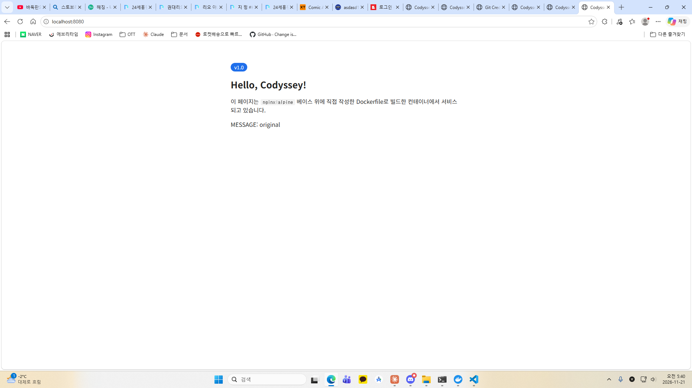
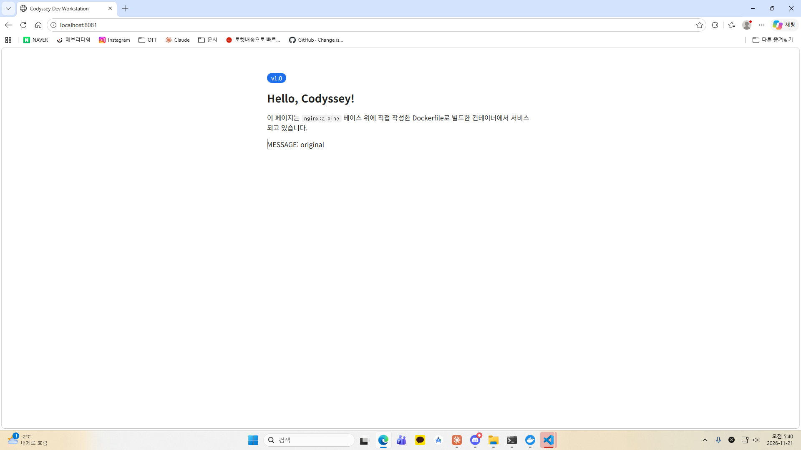
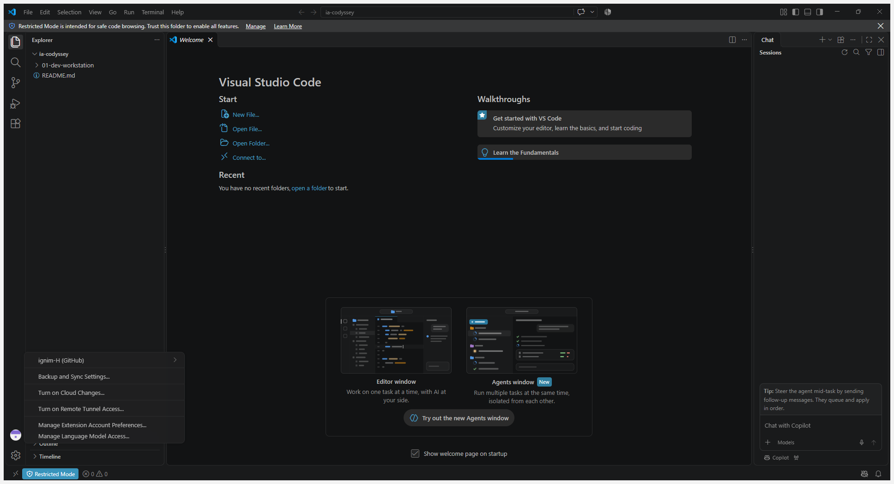

# 01. 내 컴퓨터에 개발자용 '작업실' 꾸미기

> 터미널 · Docker · Git 으로 **누가 실행해도 같은 결과가 나오는** 개발 환경을 구성하고, 그 과정을 로그로 검증한 기록입니다.

## 목차
1. [프로젝트 개요](#1-프로젝트-개요)
2. [실행 환경](#2-실행-환경)
3. [수행 체크리스트](#3-수행-체크리스트)
4. [저장소 구조 & 재현 방법](#4-저장소-구조--재현-방법)
5. [터미널 조작](#5-터미널-조작)
6. [파일 권한](#6-파일-권한)
7. [Docker 설치 점검 & 기본 운영](#7-docker-설치-점검--기본-운영)
8. [커스텀 이미지 (Dockerfile)](#8-커스텀-이미지-dockerfile)
9. [포트 매핑 접속](#9-포트-매핑-접속)
10. [바인드 마운트](#10-바인드-마운트)
11. [Docker 볼륨 영속성](#11-docker-볼륨-영속성)
12. [Git 설정 & GitHub/VSCode 연동](#12-git-설정--githubvscode-연동)
13. [트러블슈팅](#13-트러블슈팅)
14. [보너스: Docker Compose](#14-보너스-docker-compose)
15. [개념 정리](#15-개념-정리)
16. [보안 체크](#16-보안-체크)

---

## 1. 프로젝트 개요

| 항목 | 내용 |
|---|---|
| 목표 | 터미널/권한 정리 → Docker 점검·운영 → Dockerfile 로 웹 서버 컨테이너화 → 포트/마운트/볼륨 검증 → Git/GitHub 연동 |
| 핵심 원칙 | 이미지와 컨테이너의 분리, 격리된 실행 환경, 포트·스토리지 연결 |
| 검증 방식 | 모든 실습을 `scripts/*.sh` 로 실행하고, **명령어 입력과 출력 결과를 함께** `logs/*.log` 에 남긴 뒤 이 문서에 삽입 |
| 컨테이너 런타임 | Windows 개인 PC → **Docker Desktop (WSL2 백엔드)**. 캠퍼스 macOS(sudo 제한) 환경이라면 OrbStack 으로 동일하게 실행 가능 |
| 쉘 | **Git Bash** (VSCode 통합 터미널). 스크립트가 bash 기준이라 PowerShell 대신 사용 → [13-3](#13-3-powershell-에서--구문-오류) |

## 2. 실행 환경

<!-- LOG:00_env -->
```bash
# 2026-11-21 05:26:41 | 00_env
$ cmd /c ver

Microsoft Windows [Version 10.0.26300.9974]

$ uname -sm
MINGW64_NT-10.0-26300 x86_64

$ echo "SHELL=$SHELL"; $SHELL --version 2>/dev/null | head -1
SHELL=/usr/bin/bash
GNU bash, version 5.3.15(2)-release (x86_64-pc-cygwin)

$ echo "TERMINAL=${TERM_PROGRAM:-unknown} ${TERM_PROGRAM_VERSION:-}"
TERMINAL=unknown 

$ docker --version
Docker version 29.9.3, build 5457199

$ docker compose version
Docker Compose version v5.7.0

$ git --version
git version 2.56.1.windows.1

$ docker info --format 'Engine: {{.ServerVersion}} | {{.OperatingSystem}}'
Engine: 29.9.3 | Docker Desktop
```

전체 로그: [logs/00_env.log](logs/00_env.log)
<!-- /LOG:00_env -->

## 3. 수행 체크리스트

- [ ] 터미널 기본 조작 (pwd / ls -la / cd / mkdir / cp / mv / rm / cat / touch) → [5장](#5-터미널-조작)
- [ ] 권한 변경 실습 (파일 1개 + 디렉토리 1개, 전/후 비교) → [6장](#6-파일-권한)
- [ ] Docker 설치/데몬 점검 (`docker --version`, `docker info`) → [7장](#7-docker-설치-점검--기본-운영)
- [ ] 이미지/컨테이너 운영 (`images`, `ps`, `ps -a`, `logs`, `stats`) → [7장](#7-docker-설치-점검--기본-운영)
- [ ] hello-world 실행, ubuntu 컨테이너 내부 명령, attach/exec 차이 관찰 → [7장](#7-docker-설치-점검--기본-운영)
- [ ] Dockerfile 로 커스텀 이미지 빌드/실행 → [8장](#8-커스텀-이미지-dockerfile)
- [ ] 포트 매핑 접속 2회 (8080, 8081) + 브라우저 캡처 → [9장](#9-포트-매핑-접속)
- [ ] 바인드 마운트 변경 반영 → [10장](#10-바인드-마운트)
- [ ] 볼륨 영속성 (컨테이너 삭제 전/후) → [11장](#11-docker-볼륨-영속성)
- [ ] Git 설정 + VSCode GitHub 연동 → [12장](#12-git-설정--githubvscode-연동)
- [ ] 트러블슈팅 2건 이상 → [13장](#13-트러블슈팅)
- [ ] (보너스) Compose 단일/멀티 컨테이너, 운영 명령, 환경 변수 → [14장](#14-보너스-docker-compose)

## 4. 저장소 구조 & 재현 방법

```
01-dev-workstation/
├── README.md                 # 이 기술 문서
├── app/                      # 웹 서버 소스 + Dockerfile
│   ├── Dockerfile
│   ├── nginx/default.conf    # /health 엔드포인트 추가한 NGINX 설정
│   └── site/index.html       # 정적 콘텐츠
├── compose/                  # (보너스) docker-compose.yml, .env.example
├── scripts/                  # 실습 스크립트 (명령+출력 → logs/ 자동 기록)
│   ├── lib.sh                # run() 헬퍼, 민감정보 마스킹
│   ├── 00_env.sh ~ 09_compose.sh
│   ├── run_all.sh            # 전체 실행
│   ├── finish.sh             # README 갱신 → 민감정보 점검 → 커밋/push
│   └── fill_readme.pl        # logs → README 코드블록 삽입
├── logs/                     # 실행 로그 (증거)
└── docs/screenshots/         # 브라우저/VSCode 캡처
```

**재현 절차** (Windows: Docker Desktop + Git Bash / macOS: OrbStack + 터미널)

```bash
# 0) Docker Desktop(또는 OrbStack) 실행 → docker 데몬 기동 확인: docker info
git clone https://github.com/ignim-H/ia-codyssey.git
cd ia-codyssey/01-dev-workstation

# 1) 전체 실습 실행 → logs/ 생성 → README 자동 갱신
bash scripts/run_all.sh

# 또는 단계별 실행 후 README 갱신
bash scripts/04_build_run.sh
perl scripts/fill_readme.pl
```

> **환경 의존 주의사항**
> - Windows 는 반드시 **Git Bash** 에서 실행합니다 (PowerShell 5.x 는 `&&` 미지원, bash 문법 불가).
> - Git Bash 는 `/data` 같은 인자를 `C:/Program Files/Git/data` 로 바꿔 버리므로 `lib.sh` 에서 `MSYS_NO_PATHCONV=1` 을 설정했고, 바인드 마운트 경로는 `pwd -W`(→ `C:/Users/...`) 로 넘깁니다.
> - Windows 에서 `docker run -it` 인터랙티브 진입이 `the input device is not a TTY` 로 실패하면 `winpty docker run -it ...` 로 실행합니다.
> - Linux 에서 sudo 가 가능한 환경이라면 Docker Engine 을 설치해도 동일하게 동작합니다.
> - 8080/8081/8082/8090/8091/8888 포트를 사용합니다. 이미 사용 중이면 스크립트 내 포트를 바꾸세요 (`lsof -nP -iTCP:8080 -sTCP:LISTEN` 으로 확인).
> - 로그의 홈 경로 사용자명은 `<user>` 로 자동 마스킹됩니다.

---

## 5. 터미널 조작

수행: 현재 위치, 숨김 파일 포함 목록, 이동, 생성, 복사, 이동/이름변경, 삭제, 내용 확인, 빈 파일 생성 — [`scripts/01_terminal.sh`](scripts/01_terminal.sh)

<!-- LOG:01_terminal -->
```bash
# 2026-11-21 05:26:44 | 01_terminal
# --- 현재 위치 확인 / 절대경로 vs 상대경로 ---
$ pwd
/c/Users/<user>/Documents/ia-codyssey/01-dev-workstation

$ cd '/c/Users/<user>/Documents/ia-codyssey/01-dev-workstation' && pwd && cd ./scripts && pwd && cd .. && pwd
/c/Users/<user>/Documents/ia-codyssey/01-dev-workstation
/c/Users/<user>/Documents/ia-codyssey/01-dev-workstation/scripts
/c/Users/<user>/Documents/ia-codyssey/01-dev-workstation

# --- 디렉토리 생성 (-p: 중간 경로까지 한 번에) ---
$ mkdir -p 'practice/docs' 'practice/backup'

# --- 목록 확인 (숨김 파일 포함) ---
$ cd 'practice' && ls -la
total 4
drwxr-xr-x 1 user 197121 0 11월 21 05:26 .
drwxr-xr-x 1 user 197121 0 11월 21 05:26 ..
drwxr-xr-x 1 user 197121 0 11월 21 05:26 backup
drwxr-xr-x 1 user 197121 0 11월 21 05:26 docs

# --- 빈 파일 생성 / 숨김 파일 생성 ---
$ cd 'practice' && touch empty.txt .hidden_config && ls -la
total 4
drwxr-xr-x 1 user 197121 0 11월 21 05:26 .
drwxr-xr-x 1 user 197121 0 11월 21 05:26 ..
-rw-r--r-- 1 user 197121 0 11월 21 05:26 .hidden_config
drwxr-xr-x 1 user 197121 0 11월 21 05:26 backup
drwxr-xr-x 1 user 197121 0 11월 21 05:26 docs
-rw-r--r-- 1 user 197121 0 11월 21 05:26 empty.txt

# --- 파일 내용 작성 및 확인 ---
$ cd 'practice' && echo 'Hello Codyssey' > docs/note.txt && echo 'second line' >> docs/note.txt && cat docs/note.txt
Hello Codyssey
second line

$ cd 'practice' && head -n 1 docs/note.txt && wc -l docs/note.txt
Hello Codyssey
2 docs/note.txt

# --- 복사 ---
$ cd 'practice' && cp docs/note.txt backup/note_copy.txt && ls -l backup
total 1
-rw-r--r-- 1 user 197121 27 11월 21 05:26 note_copy.txt

# --- 이동 / 이름 변경 ---
$ cd 'practice' && mv backup/note_copy.txt backup/note_renamed.txt && mv empty.txt docs/ && ls -l backup docs
backup:
total 1
-rw-r--r-- 1 user 197121 27 11월 21 05:26 note_renamed.txt

docs:
total 1
-rw-r--r-- 1 user 197121  0 11월 21 05:26 empty.txt
-rw-r--r-- 1 user 197121 27 11월 21 05:26 note.txt

# --- 삭제 ---
$ cd 'practice' && rm backup/note_renamed.txt && rmdir backup && ls -la
total 4
drwxr-xr-x 1 user 197121 0 11월 21 05:26 .
drwxr-xr-x 1 user 197121 0 11월 21 05:26 ..
-rw-r--r-- 1 user 197121 0 11월 21 05:26 .hidden_config
drwxr-xr-x 1 user 197121 0 11월 21 05:26 docs

# --- 트리 형태로 최종 구조 확인 ---
$ cd 'practice' && find . | sort
.
./.hidden_config
./docs
./docs/empty.txt
./docs/note.txt
```

전체 로그: [logs/01_terminal.log](logs/01_terminal.log)
<!-- /LOG:01_terminal -->

## 6. 파일 권한

수행: 파일(`run.sh`) 644 → 755 → 644 → u+x → 444 변경 후 실행/쓰기 가능 여부 비교, 디렉토리(`secret_dir`) 700 / 300 / 600 / 755 변경 후 접근 가능 여부 비교 — [`scripts/02_permissions.sh`](scripts/02_permissions.sh)

> Windows(Git Bash)에서는 `chmod` 가 반영되지 않아 ([13-6](#13-6-windows-git-bash-에서-chmod-가-반영되지-않음)), **ubuntu 컨테이너 안에서 일반 사용자(uid 1000)로** 실습했습니다. root 는 r/w 검사를 무시하므로 일반 사용자로 실행해야 차이가 보입니다. 처음 Windows 에서 실행한 기록: [logs/02_permissions_windows.log](logs/02_permissions_windows.log)

| 표기 | 소유자 | 그룹 | 기타 | 관찰 결과 |
|---|---|---|---|---|
| 755 | rwx | r-x | r-x | 파일: 실행 가능 / 디렉토리: 누구나 목록·진입 가능 |
| 644 | rw- | r-- | r-- | 파일: `Permission denied` (실행 불가) |
| 444 | r-- | r-- | r-- | 파일: 쓰기(`>>`) 시 `Permission denied` |
| 700 | rwx | --- | --- | 디렉토리: 소유자만 접근 |
| 300 | -wx | --- | --- | 디렉토리: `ls` 불가, 파일 이름을 알면 직접 접근 가능 |
| 600 | rw- | --- | --- | 디렉토리: x 가 없어 내부 파일 접근 불가 |

<!-- LOG:02_permissions -->
```bash
# 2026-11-21 05:26:46 | 02_permissions
# --- [파일] 변경 전 ---
$ ls -l 'practice/perm/run.sh'
-rw-r--r-- 1 user 197121 23 11월 21 05:26 practice/perm/run.sh

$ ./practice/perm/run.sh
script executed

# --- [파일] chmod 755 (rwxr-xr-x) → 실행 가능 ---
$ chmod 755 'practice/perm/run.sh' && ls -l 'practice/perm/run.sh'
-rw-r--r-- 1 user 197121 23 11월 21 05:26 practice/perm/run.sh

$ ./practice/perm/run.sh
script executed

# --- [파일] chmod 644 (rw-r--r--) → 실행 불가 ---
$ chmod 644 'practice/perm/run.sh' && ls -l 'practice/perm/run.sh'
-rw-r--r-- 1 user 197121 23 11월 21 05:26 practice/perm/run.sh

$ ./practice/perm/run.sh
script executed

# --- [파일] 심볼릭 모드: u+x ---
$ chmod u+x 'practice/perm/run.sh' && ls -l 'practice/perm/run.sh'
-rw-r--r-- 1 user 197121 23 11월 21 05:26 practice/perm/run.sh

# --- [디렉토리] 변경 전 ---
$ ls -ld 'practice/perm/secret_dir' && ls 'practice/perm/secret_dir'
drwxr-xr-x 1 user 197121 0 11월 21 05:26 practice/perm/secret_dir
inside.txt

# --- [디렉토리] chmod 700 → 소유자만 접근 ---
$ chmod 700 'practice/perm/secret_dir' && ls -ld 'practice/perm/secret_dir'
drwxr-xr-x 1 user 197121 0 11월 21 05:26 practice/perm/secret_dir

# --- [디렉토리] chmod 300 (r 제거) → 목록 조회 불가, x 있으므로 파일 직접 접근은 가능 ---
$ chmod 300 'practice/perm/secret_dir' && ls -ld 'practice/perm/secret_dir' && ls 'practice/perm/secret_dir'
drwxr-xr-x 1 user 197121 0 11월 21 05:26 practice/perm/secret_dir
inside.txt

$ cat 'practice/perm/secret_dir/inside.txt'
hello

# --- [디렉토리] chmod 600 (x 제거) → 내부 진입/접근 불가 ---
$ chmod 600 'practice/perm/secret_dir' && ls -ld 'practice/perm/secret_dir' && cat 'practice/perm/secret_dir/inside.txt'
drwxr-xr-x 1 user 197121 0 11월 21 05:26 practice/perm/secret_dir
hello

# --- [디렉토리] chmod 755 로 복구 ---
$ chmod 755 'practice/perm/secret_dir' && ls -ld 'practice/perm/secret_dir' && ls 'practice/perm/secret_dir'
drwxr-xr-x 1 user 197121 0 11월 21 05:26 practice/perm/secret_dir
inside.txt
```

전체 로그: [logs/02_permissions.log](logs/02_permissions.log)
<!-- /LOG:02_permissions -->

## 7. Docker 설치 점검 & 기본 운영

수행: 버전/데몬 점검, 이미지 pull/목록, hello-world, ubuntu 내부 명령, 실행/중지/목록, attach vs exec, logs/stats — [`scripts/03_docker_basic.sh`](scripts/03_docker_basic.sh)

**attach vs exec 관찰 정리**

| | `docker attach` | `docker exec` |
|---|---|---|
| 붙는 대상 | 컨테이너의 메인 프로세스(PID 1) | 새로 띄운 별도 프로세스 |
| 거기서 `exit` 하면 | 메인 프로세스 종료 → **컨테이너도 Exited** | 그 프로세스만 종료 → **컨테이너는 Up 유지** |
| 용도 | 메인 프로세스 출력 직접 보기 | 실행 중 컨테이너 디버깅/점검 |

> 컨테이너 내부 명령(`hostname`, `cat /etc/os-release`, `ls /`) 실행 결과는 아래 로그의 `ubuntu 컨테이너 내부 명령 실행` 부분, `docker exec` 로 실행 중인 컨테이너에 들어가 명령한 결과는 `컨테이너 실행(백그라운드)` 부분에 기록했습니다.

<!-- LOG:03_docker_basic -->
```bash
# 2026-11-21 05:26:50 | 03_docker_basic
# --- 설치 및 데몬 점검 ---
$ docker --version
Docker version 29.9.3, build 5457199

$ docker info --format 'Server Version: {{.ServerVersion}} | OS: {{.OperatingSystem}} | Arch: {{.Architecture}} | CPUs: {{.NCPU}} | Mem: {{.MemTotal}} | Containers: {{.Containers}} | Images: {{.Images}}'
Server Version: 29.9.3 | OS: Docker Desktop | Arch: x86_64 | CPUs: 20 | Mem: 16670089216 | Containers: 3 | Images: 5

$ docker context ls
NAME              DESCRIPTION                               DOCKER ENDPOINT                             ERROR
default           Current DOCKER_HOST based configuration   npipe:////./pipe/docker_engine              
desktop-linux *   Docker Desktop                            npipe:////./pipe/dockerDesktopLinuxEngine   

# --- 이미지 다운로드 / 목록 ---
$ docker pull hello-world
Using default tag: latest
latest: Pulling from library/hello-world
Digest: sha256:1e4c05b897a751332ce85c7e9449da2d93514ea2dea6dbb0e2753c9e949b2bfa
Status: Image is up to date for hello-world:latest
docker.io/library/hello-world:latest

$ docker pull ubuntu:22.04
22.04: Pulling from library/ubuntu
Digest: sha256:f64b2ffc2f10ab8f8505aa56b2664bd846cbb9df87c7e2532e30f7667021c0e6
Status: Image is up to date for ubuntu:22.04
docker.io/library/ubuntu:22.04

$ docker images
IMAGE                ID             DISK USAGE   CONTENT SIZE   EXTRA
busybox:latest       a46257e06c82       6.81MB         2.23MB        
codyssey-web:1.0     0c4ddde248c0       93.9MB         26.4MB        
hello-world:latest   1e4c05b897a7       25.9kB         9.49kB        
redis:7-alpine       7f7d30b7fdd0       58.5MB         16.9MB        
ubuntu:22.04         f64b2ffc2f10        120MB         32.1MB        

# --- hello-world 실행 ---
$ docker run --name hello-test hello-world

Hello from Docker!
This message shows that your installation appears to be working correctly.

To generate this message, Docker took the following steps:
 1. The Docker client contacted the Docker daemon.
 2. The Docker daemon pulled the "hello-world" image from the Docker Hub.
    (amd64)
 3. The Docker daemon created a new container from that image which runs the
    executable that produces the output you are currently reading.
 4. The Docker daemon streamed that output to the Docker client, which sent it
    to your terminal.

To try something more ambitious, you can run an Ubuntu container with:
 $ docker run -it ubuntu bash

Share images, automate workflows, and more with a free Docker ID:
 https://hub.docker.com/

For more examples and ideas, visit:
 https://docs.docker.com/get-started/


# --- ubuntu 컨테이너 내부 명령 실행 ---
$ docker run --rm ubuntu:22.04 bash -c 'echo "inside container: $(hostname)"; cat /etc/os-release | head -2; ls /'
inside container: d20acbbf76ab
PRETTY_NAME="Ubuntu 22.04.5 LTS"
NAME="Ubuntu"
bin
boot
dev
etc
home
lib
lib32
lib64
libx32
media
mnt
opt
proc
root
run
sbin
srv
sys
tmp
usr
var

# --- 컨테이너 실행(백그라운드) / 목록 / 중지 ---
$ docker run -d --name ubuntu-keep ubuntu:22.04 sleep infinity
4db8a1d3249b2dd55536faf35dba0fe3faeea899f93d35b76ff4c933ced9fec0

$ docker ps
CONTAINER ID   IMAGE          COMMAND                   CREATED        STATUS                  PORTS                                     NAMES
4db8a1d3249b   ubuntu:22.04   "sleep infinity"          1 second ago   Up Less than a second                                             ubuntu-keep
55ab64a90e80   9caabdfedb7e   "/docker-entrypoint.…"   5 hours ago    Up 5 hours (healthy)    0.0.0.0:8082->80/tcp, [::]:8082->80/tcp   web-bind
bf7539718890   9caabdfedb7e   "/docker-entrypoint.…"   5 hours ago    Up 5 hours (healthy)    0.0.0.0:8081->80/tcp, [::]:8081->80/tcp   web-8081
04a2e63bfb2e   9caabdfedb7e   "/docker-entrypoint.…"   5 hours ago    Up 5 hours (healthy)    0.0.0.0:8080->80/tcp, [::]:8080->80/tcp   web-8080

$ docker exec ubuntu-keep bash -c 'echo hello from exec; ls /tmp'
hello from exec

$ docker stop ubuntu-keep
ubuntu-keep

$ docker ps
CONTAINER ID   IMAGE          COMMAND                   CREATED       STATUS                 PORTS                                     NAMES
55ab64a90e80   9caabdfedb7e   "/docker-entrypoint.…"   5 hours ago   Up 5 hours (healthy)   0.0.0.0:8082->80/tcp, [::]:8082->80/tcp   web-bind
bf7539718890   9caabdfedb7e   "/docker-entrypoint.…"   5 hours ago   Up 5 hours (healthy)   0.0.0.0:8081->80/tcp, [::]:8081->80/tcp   web-8081
04a2e63bfb2e   9caabdfedb7e   "/docker-entrypoint.…"   5 hours ago   Up 5 hours (healthy)   0.0.0.0:8080->80/tcp, [::]:8080->80/tcp   web-8080

$ docker ps -a
CONTAINER ID   IMAGE          COMMAND                   CREATED         STATUS                                PORTS                                     NAMES
4db8a1d3249b   ubuntu:22.04   "sleep infinity"          6 seconds ago   Exited (137) Less than a second ago                                             ubuntu-keep
a5c3880500e5   hello-world    "/hello"                  8 seconds ago   Exited (0) 7 seconds ago                                                        hello-test
55ab64a90e80   9caabdfedb7e   "/docker-entrypoint.…"   5 hours ago     Up 5 hours (healthy)                  0.0.0.0:8082->80/tcp, [::]:8082->80/tcp   web-bind
bf7539718890   9caabdfedb7e   "/docker-entrypoint.…"   5 hours ago     Up 5 hours (healthy)                  0.0.0.0:8081->80/tcp, [::]:8081->80/tcp   web-8081
04a2e63bfb2e   9caabdfedb7e   "/docker-entrypoint.…"   5 hours ago     Up 5 hours (healthy)                  0.0.0.0:8080->80/tcp, [::]:8080->80/tcp   web-8080

# --- attach vs exec 관찰 ---
$ docker run -dit --name attach-test ubuntu:22.04 bash
d502e79c5be6b5705894e826442c49be6dc9fd908a9b994799c5c83bcb72831c

$ docker exec attach-test bash -c 'exit 0'; docker ps --filter name=attach-test --format '{{.Names}} {{.Status}}'
attach-test Up Less than a second

$ echo 'exit' | docker attach attach-test; sleep 1; docker ps -a --filter name=attach-test --format '{{.Names}} {{.Status}}'
cannot attach stdin to a TTY-enabled container because stdin is not a terminal
attach-test Up 2 seconds

# --- 로그 / 리소스 확인 ---
$ docker logs hello-test | head -5

Hello from Docker!
This message shows that your installation appears to be working correctly.

To generate this message, Docker took the following steps:

$ docker start ubuntu-keep && docker stats --no-stream
ubuntu-keep
CONTAINER ID   NAME          CPU %     MEM USAGE / LIMIT     MEM %     NET I/O           BLOCK I/O         PIDS
d502e79c5be6   attach-test   0.00%     2.527MiB / 15.53GiB   0.02%     956B / 126B       238kB / 0B        1
4db8a1d3249b   ubuntu-keep   0.00%     1.316MiB / 15.53GiB   0.01%     872B / 126B       0B / 0B           1
55ab64a90e80   web-bind      0.00%     21.33MiB / 15.53GiB   0.13%     3.1kB / 3.06kB    8.82MB / 8.19kB   21
bf7539718890   web-8081      0.00%     18.21MiB / 15.53GiB   0.11%     3.04kB / 1.64kB   16.4kB / 8.19kB   21
04a2e63bfb2e   web-8080      0.00%     17.76MiB / 15.53GiB   0.11%     3.68kB / 2.02kB   16.4kB / 8.19kB   21

# --- 정리 ---
$ docker rm -f hello-test ubuntu-keep attach-test
hello-test
ubuntu-keep
attach-test

$ docker ps -a
CONTAINER ID   IMAGE          COMMAND                   CREATED       STATUS                 PORTS                                     NAMES
55ab64a90e80   9caabdfedb7e   "/docker-entrypoint.…"   5 hours ago   Up 5 hours (healthy)   0.0.0.0:8082->80/tcp, [::]:8082->80/tcp   web-bind
bf7539718890   9caabdfedb7e   "/docker-entrypoint.…"   5 hours ago   Up 5 hours (healthy)   0.0.0.0:8081->80/tcp, [::]:8081->80/tcp   web-8081
04a2e63bfb2e   9caabdfedb7e   "/docker-entrypoint.…"   5 hours ago   Up 5 hours (healthy)   0.0.0.0:8080->80/tcp, [::]:8080->80/tcp   web-8080
```

전체 로그: [logs/03_docker_basic.log](logs/03_docker_basic.log)
<!-- /LOG:03_docker_basic -->

## 8. 커스텀 이미지 (Dockerfile)

**선택 방식: (A) 웹 서버 베이스 이미지 활용** — 베이스 `nginx:alpine` (공식 이미지, 경량)

[`app/Dockerfile`](app/Dockerfile)

| # | 커스텀 포인트 | 목적 |
|---|---|---|
| 1 | `LABEL` | 이미지 제목/설명/버전 메타데이터 → `docker inspect` 로 출처 확인 |
| 2 | `ENV APP_ENV=dev` | 실행 모드를 설정으로 분리, `-e APP_ENV=prod` 로 덮어쓰기 |
| 3 | `RUN apk add curl` | 헬스체크에 필요한 도구 추가 |
| 4 | `COPY nginx/default.conf` | `/health` 엔드포인트 추가, `server_tokens off` 로 버전 노출 최소화 |
| 5 | `COPY site/` | 기본 NGINX 페이지를 내 정적 콘텐츠로 교체 |
| 6 | `HEALTHCHECK` | 10초마다 `/health` 점검 → `docker ps` 에 `(healthy)` 표시 |

빌드/실행 로그는 다음 장에 함께 기록했습니다.

## 9. 포트 매핑 접속

같은 이미지로 컨테이너 2개를 띄우고 호스트 포트만 다르게 매핑 (`8080:80`, `8081:80`) — [`scripts/04_build_run.sh`](scripts/04_build_run.sh)

| http://localhost:8080 | http://localhost:8081 |
|---|---|
|  |  |

<!-- LOG:04_build_run -->
```bash
# 2026-11-21 05:27:12 | 04_build_run
# --- Dockerfile 내용 ---
$ cat 'app/Dockerfile'
# 베이스: 공식 nginx:alpine 이미지 (방식 A - 웹 서버 베이스 + 콘텐츠/설정 교체)
FROM nginx:alpine

# [커스텀 1] 이미지 메타데이터 - docker inspect 로 이미지 출처/용도 확인 가능
LABEL org.opencontainers.image.title="codyssey-web" \
      org.opencontainers.image.description="Codyssey 개발 워크스테이션 미션용 커스텀 NGINX" \
      org.opencontainers.image.version="1.0"

# [커스텀 2] 환경 변수 - 실행 모드 표시용 (docker run -e APP_ENV=prod 로 덮어쓰기 가능)
ENV APP_ENV=dev

# [커스텀 3] 헬스체크용 curl 설치 (alpine 기본 이미지에는 없음)
RUN apk add --no-cache curl

# [커스텀 4] 기본 설정 교체 - /health 엔드포인트 추가, 서버 정보 노출 최소화
COPY nginx/default.conf /etc/nginx/conf.d/default.conf

# [커스텀 5] 정적 콘텐츠 교체
COPY site/ /usr/share/nginx/html/

# [커스텀 6] 컨테이너 상태 자동 점검 - docker ps 의 STATUS 에 (healthy) 표시
HEALTHCHECK --interval=10s --timeout=3s --start-period=5s --retries=3 \
  CMD curl -fsS http://localhost/health || exit 1

EXPOSE 80

# --- 빌드 ---
$ docker build -t codyssey-web:1.0 'app'
#0 building with "desktop-linux" instance using docker driver

#1 [internal] load build definition from Dockerfile
#1 transferring dockerfile: 1.17kB done
#1 DONE 0.0s

#2 [internal] load metadata for docker.io/library/nginx:alpine
#2 ...

#3 [auth] library/nginx:pull token for registry-1.docker.io
#3 DONE 0.0s

#2 [internal] load metadata for docker.io/library/nginx:alpine
#2 DONE 1.3s

#4 [internal] load .dockerignore
#4 transferring context: 2B done
#4 DONE 0.0s

#5 [internal] load build context
#5 transferring context: 124B done
#5 DONE 0.0s

#6 [1/4] FROM docker.io/library/nginx:alpine@sha256:fb4658584bd9a916ffb6f6e365f97c25cfdb2923801f551ea08356e695f14ff7
#6 resolve docker.io/library/nginx:alpine@sha256:fb4658584bd9a916ffb6f6e365f97c25cfdb2923801f551ea08356e695f14ff7 0.0s done
#6 DONE 0.0s

#7 [2/4] RUN apk add --no-cache curl
#7 CACHED

#8 [3/4] COPY nginx/default.conf /etc/nginx/conf.d/default.conf
#8 CACHED

#9 [4/4] COPY site/ /usr/share/nginx/html/
#9 CACHED

#10 exporting to image
#10 exporting layers done
#10 exporting manifest sha256:223c23cf4e559864a0a5074c7dad96ef8329f7ceb3700cdcd76923455a16db78 0.0s done
#10 exporting config sha256:27ae264753b1efe88fadf7ba3cc4af0acf07d441a4819232a3b34685434c94ad done
#10 exporting attestation manifest sha256:46695c493dec0727904d744dc8b44c8dc508e994bea0649f00bdeef1eadcc07c 0.0s done
#10 exporting manifest list sha256:5c7bed3de0d16faba81c1c147f40386cc0ab33fa609522ff3843cb3d5e08ca99 0.0s done
#10 naming to docker.io/library/codyssey-web:1.0 done
#10 unpacking to docker.io/library/codyssey-web:1.0 done
#10 DONE 0.2s

$ docker images codyssey-web
IMAGE              ID             DISK USAGE   CONTENT SIZE   EXTRA
codyssey-web:1.0   5c7bed3de0d1       93.9MB         26.4MB   U    

$ docker inspect codyssey-web:1.0 --format '{{json .Config.Labels}}'
{"maintainer":"NGINX Docker Maintainers <docker-maint@nginx.com>","org.opencontainers.image.description":"Codyssey 개발 워크스테이션 미션용 커스텀 NGINX","org.opencontainers.image.title":"codyssey-web","org.opencontainers.image.version":"1.0"}

$ docker inspect codyssey-web:1.0 --format '{{json .Config.Env}}'
["PATH=/usr/local/sbin:/usr/local/bin:/usr/sbin:/usr/bin:/sbin:/bin","NGINX_VERSION=1.31.9","PKG_RELEASE=1","DYNPKG_RELEASE=1","NJS_VERSION=1.0.2","NJS_RELEASE=1","ACME_VERSION=0.4.2","APP_ENV=dev"]

# --- 포트 매핑 실행 (호스트 8080 → 컨테이너 80) ---
$ docker run -d -p 8080:80 --name web-8080 codyssey-web:1.0
689d880778174dd0a85bb3f7b2b54e2928ac6902f6747afa7228966d72e6b6e3

# --- 포트 매핑 실행 (호스트 8081 → 컨테이너 80, 같은 이미지로 두 번째 컨테이너) ---
$ docker run -d -p 8081:80 -e APP_ENV=prod --name web-8081 codyssey-web:1.0
6cb43bef86e3c58988355599ebe41c80d56dd1245d3adc7de64067beffe34bd1

$ docker ps --format 'table {{.Names}}\t{{.Image}}\t{{.Ports}}\t{{.Status}}'
NAMES      IMAGE              PORTS                                     STATUS
web-8081   codyssey-web:1.0   0.0.0.0:8081->80/tcp, [::]:8081->80/tcp   Up 3 seconds (health: starting)
web-8080   codyssey-web:1.0   0.0.0.0:8080->80/tcp, [::]:8080->80/tcp   Up 4 seconds (health: starting)
web-bind   9caabdfedb7e       0.0.0.0:8082->80/tcp, [::]:8082->80/tcp   Up 5 hours (healthy)

$ curl -s http://localhost:8080 | grep -E '<h1>|MESSAGE'
  <h1>Hello, Codyssey!</h1>
  <p id="message">MESSAGE: original</p>

$ curl -s http://localhost:8081 | grep -E '<h1>|MESSAGE'
  <h1>Hello, Codyssey!</h1>
  <p id="message">MESSAGE: original</p>

$ curl -si http://localhost:8080/health
HTTP/1.1 200 OK
Server: nginx
Date: Fri, 20 Nov 2026 20:27:22 GMT
Content-Type: text/plain
Content-Length: 3
Connection: keep-alive

ok

$ docker exec web-8081 printenv APP_ENV
prod

# --- 헬스체크 상태 확인 (start-period 이후) ---
$ docker inspect web-8080 --format '{{.State.Health.Status}}'
healthy

$ docker logs web-8080 | tail -5
2026/11/20 20:27:17 [notice] 1#1: using the "epoll" event method
2026/11/20 20:27:17 [notice] 1#1: nginx/1.31.9
2026/11/20 20:27:17 [notice] 1#1: built by gcc 15.2.0 (Alpine 15.2.0) 
2026/11/20 20:27:17 [notice] 1#1: OS: Linux 6.18.58.1-microsoft-standard-WSL2
2026/11/20 20:27:17 [notice] 1#1: getrlimit(RLIMIT_NOFILE): 1048576:1048576
2026/11/20 20:27:17 [notice] 1#1: start worker processes
2026/11/20 20:27:17 [notice] 1#1: start worker process 29
2026/11/20 20:27:17 [notice] 1#1: start worker process 30
2026/11/20 20:27:17 [notice] 1#1: start worker process 31
2026/11/20 20:27:17 [notice] 1#1: start worker process 32
2026/11/20 20:27:17 [notice] 1#1: start worker process 33
2026/11/20 20:27:17 [notice] 1#1: start worker process 34
2026/11/20 20:27:17 [notice] 1#1: start worker process 35
2026/11/20 20:27:17 [notice] 1#1: start worker process 36
2026/11/20 20:27:17 [notice] 1#1: start worker process 37
2026/11/20 20:27:17 [notice] 1#1: start worker process 38
2026/11/20 20:27:17 [notice] 1#1: start worker process 39
2026/11/20 20:27:17 [notice] 1#1: start worker process 40
2026/11/20 20:27:17 [notice] 1#1: start worker process 41
2026/11/20 20:27:17 [notice] 1#1: start worker process 42
2026/11/20 20:27:17 [notice] 1#1: start worker process 43
2026/11/20 20:27:17 [notice] 1#1: start worker process 44
2026/11/20 20:27:17 [notice] 1#1: start worker process 45
2026/11/20 20:27:17 [notice] 1#1: start worker process 46
2026/11/20 20:27:17 [notice] 1#1: start worker process 47
2026/11/20 20:27:17 [notice] 1#1: start worker process 48
/docker-entrypoint.sh: Sourcing /docker-entrypoint.d/15-local-resolvers.envsh
/docker-entrypoint.sh: Launching /docker-entrypoint.d/20-envsubst-on-templates.sh
/docker-entrypoint.sh: Launching /docker-entrypoint.d/30-tune-worker-processes.sh
/docker-entrypoint.sh: Configuration complete; ready for start up
172.17.0.1 - - [20/Nov/2026:20:27:22 +0000] "GET / HTTP/1.1" 200 865 "-" "curl/8.23.0" "-"
```

전체 로그: [logs/04_build_run.log](logs/04_build_run.log)
<!-- /LOG:04_build_run -->

## 10. 바인드 마운트

호스트의 `practice/bind-site/` 를 컨테이너 웹 루트에 연결하고, **호스트에서만** 파일을 수정한 뒤 재빌드/재시작 없이 응답이 바뀌는지 확인 — [`scripts/05_bind_mount.sh`](scripts/05_bind_mount.sh)

<!-- LOG:05_bind_mount -->
```bash
# 2026-11-21 05:27:34 | 05_bind_mount
# --- 호스트 디렉토리를 컨테이너 웹 루트에 바인드 마운트 ---
$ docker run -d -p 8082:80 --name web-bind -v 'C:/Users/<user>/Documents/ia-codyssey/01-dev-workstation/practice/bind-site':/usr/share/nginx/html codyssey-web:1.0
4e8b0ab3d75dd8c9e619bcdf85193f982c5257525935751d32190ef29ed8b297

$ docker inspect web-bind --format '{{range .Mounts}}{{.Type}}: {{.Source}} -> {{.Destination}}{{end}}'
bind: C:/Users/<user>/Documents/ia-codyssey/01-dev-workstation/practice/bind-site -> /usr/share/nginx/html

# --- 변경 전 ---
$ grep MESSAGE 'practice/bind-site/index.html'
  <p id="message">MESSAGE: original</p>

$ curl -s http://localhost:8082 | grep MESSAGE
  <p id="message">MESSAGE: original</p>

# --- 호스트에서 파일 수정 (컨테이너 재시작/재빌드 없음) ---
$ sed -i.bak 's/MESSAGE: original/MESSAGE: changed on host at 05:27:39/' 'practice/bind-site/index.html' && rm -f 'practice/bind-site/index.html.bak'

# --- 변경 후 ---
$ grep MESSAGE 'practice/bind-site/index.html'
  <p id="message">MESSAGE: changed on host at 05:27:39</p>

$ curl -s http://localhost:8082 | grep MESSAGE
  <p id="message">MESSAGE: changed on host at 05:27:39</p>

$ docker exec web-bind grep MESSAGE /usr/share/nginx/html/index.html
  <p id="message">MESSAGE: changed on host at 05:27:39</p>
```

전체 로그: [logs/05_bind_mount.log](logs/05_bind_mount.log)
<!-- /LOG:05_bind_mount -->

## 11. Docker 볼륨 영속성

볼륨 `codyssey-data` 를 `/data` 에 연결 → 기록 → **컨테이너 삭제** → 새 컨테이너에 같은 볼륨 연결 → 데이터 확인. 비교군으로 볼륨 밖 `/tmp` 파일은 사라지는 것도 확인 — [`scripts/06_volume.sh`](scripts/06_volume.sh)

<!-- LOG:06_volume -->
```bash
# 2026-11-21 05:27:41 | 06_volume
# --- 볼륨 생성 / 확인 ---
$ docker volume create codyssey-data
codyssey-data

$ docker volume ls --filter name=codyssey-data
DRIVER    VOLUME NAME
local     codyssey-data

$ docker volume inspect codyssey-data --format '{{.Name}} | driver={{.Driver}} | mountpoint={{.Mountpoint}}'
codyssey-data | driver=local | mountpoint=/var/lib/docker/volumes/codyssey-data/_data

# --- 컨테이너 1 에 볼륨 연결 후 데이터 기록 ---
$ docker run -d --name vol-test -v codyssey-data:/data ubuntu:22.04 sleep infinity
af34f0e449622fc76f85a0e95ebdaa64adaa9b05fb59b6965bb759a103bb8d6c

$ docker exec vol-test bash -c 'echo "saved at $(date)" > /data/hello.txt && cat /data/hello.txt'
saved at Fri Nov 20 20:27:44 UTC 2026

# --- 비교용: 볼륨 밖(/tmp)에도 기록 ---
$ docker exec vol-test bash -c 'echo temp > /tmp/temp.txt && ls /tmp/temp.txt'
/tmp/temp.txt

# --- 컨테이너 1 삭제 ---
$ docker rm -f vol-test
vol-test

$ docker ps -a --filter name=vol-test
CONTAINER ID   IMAGE     COMMAND   CREATED   STATUS    PORTS     NAMES

# --- 새 컨테이너 2 에 같은 볼륨 연결 → 데이터 유지 확인 ---
$ docker run -d --name vol-test2 -v codyssey-data:/data ubuntu:22.04 sleep infinity
6dea44ebc7e5a7af6663199e4cd21c124aa1a13454576b14592731f1e934eed1

$ docker exec vol-test2 cat /data/hello.txt
saved at Fri Nov 20 20:27:44 UTC 2026

$ docker exec vol-test2 ls /tmp/temp.txt
ls: cannot access '/tmp/temp.txt': No such file or directory

# --- 정리 (볼륨은 남겨 둠: 'docker volume rm codyssey-data' 로 삭제 가능) ---
$ docker rm -f vol-test2
vol-test2
```

전체 로그: [logs/06_volume.log](logs/06_volume.log)
<!-- /LOG:06_volume -->

## 12. Git 설정 & GitHub/VSCode 연동

사전 설정:

```bash
git config --global user.name  "<이름>"
git config --global user.email "<GitHub noreply 이메일 권장>"
git config --global init.defaultBranch main
```

<!-- LOG:07_git -->
```bash
# 2026-11-21 05:28:36 | 07_git
$ git --version
git version 2.56.1.windows.1

$ git config --list --show-origin | grep -viE 'credential|token|password|helper'
file:C:/Program Files/Git/etc/gitconfig	diff.astextplain.textconv=astextplain
file:C:/Program Files/Git/etc/gitconfig	filter.lfs.clean=git-lfs clean -- %f
file:C:/Program Files/Git/etc/gitconfig	filter.lfs.smudge=git-lfs smudge -- %f
file:C:/Program Files/Git/etc/gitconfig	filter.lfs.process=git-lfs filter-process
file:C:/Program Files/Git/etc/gitconfig	filter.lfs.required=true
file:C:/Program Files/Git/etc/gitconfig	http.sslbackend=schannel
file:C:/Program Files/Git/etc/gitconfig	core.autocrlf=true
file:C:/Program Files/Git/etc/gitconfig	core.fscache=true
file:C:/Program Files/Git/etc/gitconfig	core.symlinks=false
file:C:/Program Files/Git/etc/gitconfig	pull.rebase=false
file:C:/Program Files/Git/etc/gitconfig	init.defaultbranch=master
file:C:/Users/<user>/.gitconfig	user.name=ignim
file:C:/Users/<user>/.gitconfig	user.email=192585468+ignim-H@users.noreply.github.com
file:C:/Users/<user>/.gitconfig	init.defaultbranch=main
file:.git/config	core.repositoryformatversion=0
file:.git/config	core.filemode=false
file:.git/config	core.bare=false
file:.git/config	core.logallrefupdates=true
file:.git/config	core.symlinks=false
file:.git/config	core.ignorecase=true
file:.git/config	remote.origin.url=https://github.com/ignim-H/ia-codyssey.git
file:.git/config	remote.origin.fetch=+refs/heads/*:refs/remotes/origin/*

$ git config --global user.name
ignim

$ git config --global init.defaultBranch
main

$ git remote -v
origin	https://github.com/ignim-H/ia-codyssey.git (fetch)
origin	https://github.com/ignim-H/ia-codyssey.git (push)

$ git branch -vv
* main c9d4db6 Initial commit

$ git log --oneline -5
c9d4db6 Initial commit
```

전체 로그: [logs/07_git.log](logs/07_git.log)
<!-- /LOG:07_git -->

**VSCode GitHub 연동 증거** (계정 메뉴의 GitHub 로그인 상태 + Source Control 원격 저장소)



## 13. 트러블슈팅

오류를 일부러 재현하고 해결 과정을 로그로 남겼습니다 — [`scripts/08_troubleshoot.sh`](scripts/08_troubleshoot.sh)

### 13-1. 포트 충돌 (`port is already allocated`)
- **문제**: 같은 호스트 포트 8090 으로 두 번째 컨테이너 실행 시 실패
- **원인 가설**: 호스트 포트 하나는 한 프로세스만 점유할 수 있다. 컨테이너 포트(80)는 각자 격리돼 있어도 호스트 쪽은 공유 자원이다.
- **확인**: `docker ps --filter publish=8090` 으로 점유 컨테이너 확인, Windows 는 `netstat -ano | grep ':8090 '` (macOS/Linux 는 `lsof -nP -iTCP:8090`)
- **해결**: 실패한 컨테이너 삭제 후 다른 호스트 포트(8091)로 실행 → HTTP 200

### 13-2. 컨테이너 이름 중복 (`Conflict. The container name ... is already in use`)
- **문제**: 같은 `--name` 으로 컨테이너 재실행 시 실패
- **원인 가설**: 중지(Exited)된 컨테이너도 삭제 전까지 이름을 점유한다.
- **확인**: `docker ps -a --filter name=ts-name`
- **해결**: `docker rm -f` 후 재실행. 일회성 실행은 `--rm` 옵션 습관화

### 13-3. PowerShell 에서 `&&` 구문 오류
- **문제**: VSCode 터미널에 `cd ~ && git clone ... && bash scripts/run_all.sh` 를 붙여넣자 `'&&' 토큰은 이 버전에서 올바른 문 구분 기호가 아닙니다` (ParserError) 발생
- **원인 가설**: VSCode 기본 터미널이 Windows PowerShell 5.1 이고, `&&` 연산자는 PowerShell 7 부터 지원된다. 또한 스크립트 자체가 bash 문법이다.
- **확인**: 터미널 탭 우측 셸 이름이 `powershell`, `$PSVersionTable.PSVersion` 으로 버전 확인
- **해결**: 터미널 `+` 옆 ▼ → **Git Bash** 선택 후 재실행. 기본 셸을 Git Bash 로 바꿔 재발 방지 (`Terminal: Select Default Profile`)

### 13-4. Windows 에 OrbStack 설치 시도 (`.dmg` 실행 불가)
- **문제**: 과제 안내대로 OrbStack 을 받았는데 `OrbStack_v2.x_amd64.dmg` 가 실행되지 않고 VSCode 에서 깨진 바이너리로 열림
- **원인 가설**: `.dmg` 는 macOS 디스크 이미지 형식 → OrbStack 은 macOS 전용 앱
- **확인**: 공식 사이트 지원 OS 확인, 파일 확장자 확인
- **해결/대안**: Windows 에서는 **Docker Desktop (WSL2 백엔드)** 설치. `docker` CLI 사용법은 동일하므로 이후 절차는 변경 없음. 데몬이 꺼져 있으면 `Cannot connect to the Docker daemon` → Docker Desktop 실행 후 `docker info` 재확인 (스크립트의 `require_docker` 가 미리 점검)

### 13-5. Docker Desktop 설치 실패 (`Virtual Machine Platform` 미활성화)
- **문제**: 설치 중 `Docker Desktop requires the "Virtual Machine Platform" Windows feature, which is not enabled on this machine.` / `A per-user installation cannot enable it`
- **원인 가설**: Docker Desktop 은 WSL2 경량 VM 위에서 Linux 엔진을 돌리는데, 그 기반인 Windows 기능이 꺼져 있고, 사용자 단위 설치로는 관리자 권한이 필요한 기능을 켤 수 없다.
- **확인**: 에러 메시지에 필요한 기능과 권한 조건이 명시됨
- **해결**: 관리자 PowerShell 에서 `wsl --install` → 재부팅 → 설치 파일 재실행 시 **All-users installation** 선택 → `docker info` 로 엔진 동작 확인
- **배운 점**: 컨테이너는 호스트 커널을 공유하므로 Windows/macOS 에서는 Linux VM 이 반드시 한 겹 필요하다 (macOS 의 OrbStack 도 같은 구조).

### 13-6. Windows Git Bash 에서 `chmod` 가 반영되지 않음
- **문제**: `chmod 755`, `chmod 644`, `chmod 700` 을 해도 `ls -l` 결과가 계속 `-rw-r--r--` / `drwxr-xr-x` 이고, 644 인데도 `./run.sh` 가 실행됨 → [logs/02_permissions_windows.log](logs/02_permissions_windows.log)
- **원인 가설**: Windows 파일시스템(NTFS)은 리눅스식 rwx 권한 비트가 아니라 ACL 로 권한을 관리한다. Git Bash 는 권한을 흉내만 내므로 `chmod` 가 저장되지 않고, 실행 여부도 권한이 아니라 파일 내용(`#!`)·확장자로 판단한다.
- **확인**: 같은 명령을 리눅스 파일시스템(ubuntu 컨테이너 내부)에서 실행하면 `ls -l` 결과가 바뀌고 `Permission denied` 가 정상적으로 발생
- **해결**: 권한 실습을 `docker run --user 1000:1000 ubuntu:22.04` 안에서 수행하도록 `02_permissions.sh` 수정. Git 저장소에서는 `git update-index --chmod=+x` 로 실행 비트를 기록할 수 있음
- **배운 점**: 권한 모델은 OS/파일시스템마다 다르다. 컨테이너를 쓰면 호스트 OS 와 무관하게 같은 리눅스 동작을 재현할 수 있다.

<!-- LOG:08_troubleshoot -->
```bash
# 2026-11-21 05:27:50 | 08_troubleshoot
# --- [케이스 1] 포트 충돌: 같은 호스트 포트(8090)를 두 컨테이너가 사용 ---
$ docker run -d -p 8090:80 --name ts-a codyssey-web:1.0
594dd0324faf020b5203f3a267a72d42a6a0ba71d4f0cc73c760be90695c013e

$ docker run -d -p 8090:80 --name ts-b codyssey-web:1.0
80d44f6aeef639ebcf0baa698e6f15a083e11771f2c41ac5cae3793931766c16
docker: Error response from daemon: failed to set up container networking: driver failed programming external connectivity on endpoint ts-b (1fbea153c3cbc83d3c045174086ff7fcf4e30efb6b0f0d24b9504940fbf0633b): Bind for 0.0.0.0:8090 failed: port is already allocated

Run 'docker run --help' for more information

# --- 확인: 누가 8090 을 쓰고 있는가 ---
$ docker ps --filter publish=8090 --format '{{.Names}} {{.Ports}}'
ts-a 0.0.0.0:8090->80/tcp, [::]:8090->80/tcp

$ lsof -nP -iTCP:8090 -sTCP:LISTEN 2>/dev/null | head -3 || netstat -ano | grep ':8090' | head -3

# --- 해결: 생성 실패한 컨테이너 제거 후 다른 호스트 포트(8091)로 실행 ---
$ docker rm -f ts-b; docker run -d -p 8091:80 --name ts-b codyssey-web:1.0
ts-b
aa61c97a8506a6a2f0977ac826d5539041606c762b8b5487247ce88bbdb729ca

$ curl -s -o /dev/null -w 'HTTP %{http_code}\n' http://localhost:8091
HTTP 200

# --- [케이스 2] 컨테이너 이름 중복 ---
$ docker run -d --name ts-name ubuntu:22.04 sleep 60
62fba90448994ad7349f031aca95b97fd9f013418b265485deae578b48e614e8

$ docker run -d --name ts-name ubuntu:22.04 sleep 60
docker: Error response from daemon: Conflict. The container name "/ts-name" is already in use by container "62fba90448994ad7349f031aca95b97fd9f013418b265485deae578b48e614e8". You have to remove (or rename) that container to be able to reuse that name.

Run 'docker run --help' for more information

# --- 확인: 중지된 컨테이너도 이름을 점유한다 ---
$ docker ps -a --filter name=ts-name --format '{{.Names}} {{.Status}}'
ts-name Up Less than a second

# --- 해결: 기존 컨테이너 삭제 후 재실행 (또는 --rm 사용) ---
$ docker rm -f ts-name && docker run -d --name ts-name ubuntu:22.04 sleep 60
ts-name
3cf5c6af89ec23108d8d8cf2e71884b7303cf4be2563bc8aed967d590204442e

# --- 정리 ---
$ docker rm -f ts-a ts-b ts-name
ts-a
ts-b
ts-name
```

전체 로그: [logs/08_troubleshoot.log](logs/08_troubleshoot.log)
<!-- /LOG:08_troubleshoot -->

## 14. 보너스: Docker Compose

[`compose/docker-compose.yml`](compose/docker-compose.yml) — `web`(커스텀 NGINX) + `redis` + `client`(busybox) 3개 서비스

- **문서화된 실행 설정**: 길었던 `docker run -d -p ... -e ... --name ...` 이 YAML 한 파일로 바뀌어 누구나 `docker compose up` 한 줄로 재현
- **서비스 디스커버리**: `client` 에서 IP 가 아니라 서비스 이름 `http://web` 으로 접속, `web` 에서 `redis:6379` 로 접속
- **환경 변수**: `WEB_PORT`, `APP_ENV` 를 `.env` 로 주입 → 코드 수정 없이 포트/모드 변경 (`cp compose/.env.example compose/.env`)
- **운영 루틴**: `up -d` → `ps` → `logs` → `down`

<!-- LOG:09_compose -->
```bash
# 2026-11-21 05:27:59 | 09_compose
$ cat 'compose/docker-compose.yml'
services:
  web:
    build: ../app
    image: codyssey-web:1.0
    ports:
      - "${WEB_PORT:-8888}:80"      # 호스트 포트는 .env 또는 환경 변수로 변경
    environment:
      APP_ENV: ${APP_ENV:-compose}   # 실행 모드 주입
    depends_on:
      - redis

  redis:
    image: redis:7-alpine

  client:
    image: busybox:latest
    command: sleep infinity           # 네트워크 통신 테스트용 보조 컨테이너
    depends_on:
      - web

$ cd 'compose' && docker compose up -d --build
 Image codyssey-web:1.0 Building 
#1 [internal] load local bake definitions
#1 reading from stdin 574B 0.0s done
#1 DONE 0.0s

#2 [internal] load build definition from Dockerfile
#2 transferring dockerfile: 1.17kB done
#2 DONE 0.0s

#3 [internal] load metadata for docker.io/library/nginx:alpine
#3 DONE 0.8s

#4 [internal] load .dockerignore
#4 transferring context: 2B done
#4 DONE 0.0s

#5 [internal] load build context
#5 transferring context: 124B done
#5 DONE 0.0s

#6 [1/4] FROM docker.io/library/nginx:alpine@sha256:fb4658584bd9a916ffb6f6e365f97c25cfdb2923801f551ea08356e695f14ff7
#6 resolve docker.io/library/nginx:alpine@sha256:fb4658584bd9a916ffb6f6e365f97c25cfdb2923801f551ea08356e695f14ff7 0.0s done
#6 DONE 0.0s

#7 [2/4] RUN apk add --no-cache curl
#7 CACHED

#8 [3/4] COPY nginx/default.conf /etc/nginx/conf.d/default.conf
#8 CACHED

#9 [4/4] COPY site/ /usr/share/nginx/html/
#9 CACHED

#10 exporting to image
#10 exporting layers done
#10 exporting manifest sha256:b03b340229173f873a416e31a390a894bcfbb4585ef4c721b94c61f7958b2ed2 done
#10 exporting config sha256:98d4a8f576b36a7566306c154dae11d588ed48eb7eac427e72668485aaa18bd5 done
#10 exporting attestation manifest sha256:73253fe67afbf431b68eff148388195f0d8971513f6e325306185abf8f5f0aee 0.0s done
#10 exporting manifest list sha256:29ddbcb426ffa0b3cbd91e2567214c97d3e08b41c0dd4ff378a087cdaea7ac69 0.0s done
#10 naming to docker.io/library/codyssey-web:1.0 done
#10 unpacking to docker.io/library/codyssey-web:1.0 0.0s done
#10 DONE 0.2s

#11 resolving provenance for metadata file
#11 DONE 0.0s
 Image codyssey-web:1.0 Built 
 Network compose_default Creating 
 Network compose_default Creating 
 Network compose_default Created 
 Network compose_default Created 
 Container compose-redis-1 Creating 
 Container compose-redis-1 Created 
 Container compose-web-1 Creating 
 Container compose-web-1 Created 
 Container compose-client-1 Creating 
 Container compose-client-1 Created 
 Container compose-redis-1 Starting 
 Container compose-redis-1 Started 
 Container compose-web-1 Starting 
 Container compose-web-1 Started 
 Container compose-client-1 Starting 
 Container compose-client-1 Started 

$ cd 'compose' && docker compose ps
NAME               IMAGE              COMMAND                   SERVICE   CREATED         STATUS                   PORTS
compose-client-1   busybox:latest     "sleep infinity"          client    9 seconds ago   Up 8 seconds             
compose-redis-1    redis:7-alpine     "docker-entrypoint.s…"   redis     9 seconds ago   Up 9 seconds             6379/tcp
compose-web-1      codyssey-web:1.0   "/docker-entrypoint.…"   web       9 seconds ago   Up 8 seconds (healthy)   0.0.0.0:8888->80/tcp, [::]:8888->80/tcp

# --- 서비스 이름(web)으로 컨테이너 간 통신 확인 (서비스 디스커버리) ---
$ cd 'compose' && docker compose exec -T client wget -qO- http://web/health
ok

$ cd 'compose' && docker compose exec -T client wget -qO- http://web | grep '<h1>'
  <h1>Hello, Codyssey!</h1>

# --- redis 서비스에 이름으로 접속 ---
$ cd 'compose' && docker compose exec -T web sh -c 'printf "PING\r\n" | nc -w 2 redis 6379'
+PONG

# --- 환경 변수로 호스트 포트/모드 변경 ---
$ cd 'compose' && docker compose exec -T web printenv APP_ENV
compose

$ curl -s -o /dev/null -w 'HTTP %{http_code}\n' http://localhost:${WEB_PORT:-8888}
HTTP 200

$ cd 'compose' && docker compose logs --tail 5 web
web-1  | 2026/11/20 20:28:02 [notice] 1#1: start worker process 46
web-1  | 2026/11/20 20:28:02 [notice] 1#1: start worker process 47
web-1  | 2026/11/20 20:28:02 [notice] 1#1: start worker process 48
web-1  | 172.18.0.4 - - [20/Nov/2026:20:28:12 +0000] "GET / HTTP/1.1" 200 865 "-" "Wget" "-"
web-1  | 172.18.0.1 - - [20/Nov/2026:20:28:14 +0000] "GET / HTTP/1.1" 200 865 "-" "curl/8.23.0" "-"

$ cd 'compose' && docker compose down
 Container compose-client-1 Stopping 
 Container compose-client-1 Stopped 
 Container compose-client-1 Removing 
 Container compose-client-1 Removed 
 Container compose-web-1 Stopping 
 Container compose-web-1 Stopped 
 Container compose-web-1 Removing 
 Container compose-web-1 Removed 
 Container compose-redis-1 Stopping 
 Container compose-redis-1 Stopped 
 Container compose-redis-1 Removing 
 Container compose-redis-1 Removed 
 Network compose_default Removing 
 Network compose_default Removed 

$ cd 'compose' && docker compose ps
NAME      IMAGE     COMMAND   SERVICE   CREATED   STATUS    PORTS
```

전체 로그: [logs/09_compose.log](logs/09_compose.log)
<!-- /LOG:09_compose -->

## 15. 개념 정리

**절대 경로 vs 상대 경로**
- 절대 경로: 루트(`/`)부터 시작하는 전체 주소. 현재 위치와 무관하게 항상 같은 곳 → `/Users/<user>/ia-codyssey/01-dev-workstation/app`
- 상대 경로: 현재 위치 기준. `./app`(현재 폴더 안), `../`(상위 폴더). 같은 `./app` 도 어디서 실행하느냐에 따라 가리키는 곳이 다르다.
- 이 프로젝트 스크립트는 `lib.sh` 에서 미션 폴더로 먼저 이동한 뒤 상대 경로를 써서, 저장소를 어디에 clone 해도 동작하게 했다.

**권한 r/w/x 와 숫자 표기**
- r=4, w=2, x=1 을 더한 값을 소유자/그룹/기타 순서로 3자리 표기. `755` = 7(rwx) 5(r-x) 5(r-x), `644` = 6(rw-) 4(r--) 4(r--)
- 파일의 x 는 "실행", 디렉토리의 x 는 "진입/내부 접근", 디렉토리의 r 은 "목록 조회"

**포트 매핑이 필요한 이유**
- 컨테이너는 격리된 네트워크를 가져서 컨테이너의 80 포트는 호스트에서 바로 보이지 않는다. `-p 호스트:컨테이너` 로 호스트 포트를 컨테이너 포트로 연결해야 외부(브라우저)에서 접근 가능.
- 같은 이미지로 여러 컨테이너를 띄울 때 컨테이너 포트는 같아도 호스트 포트만 다르게 주면 된다(8080, 8081).

**Docker 볼륨**
- 컨테이너의 쓰기 레이어는 컨테이너 삭제 시 함께 사라진다. 볼륨은 Docker 가 관리하는 별도 저장소라 컨테이너 수명과 분리된다.
- 바인드 마운트는 "호스트의 특정 경로"를 연결(개발 중 즉시 반영용), 볼륨은 "Docker 가 관리하는 저장소"를 연결(DB 등 데이터 영속용).

**이미지 vs 컨테이너**
- 이미지 = 읽기 전용 설계도(빌드 결과), 컨테이너 = 이미지로 띄운 실행 인스턴스. 이미지 하나로 컨테이너 여러 개 실행 가능.

**Git vs GitHub**
- Git: 내 컴퓨터에서 동작하는 버전 관리 도구 (commit, branch, log)
- GitHub: Git 저장소를 원격에 호스팅하고 PR/이슈/리뷰로 협업하는 플랫폼 (push/pull 대상)

## 16. 보안 체크

- [ ] `lib.sh` 의 `mask()` 로 토큰(`ghp_...`), `password=`/`token=` 류 값, 홈 디렉토리 사용자명 자동 마스킹
- [ ] `git config --list` 기록 시 credential/token/helper 줄 제외
- [ ] 스크린샷에 이메일·토큰·인증 코드가 보이면 모자이크 후 업로드
- [ ] 커밋 전 점검: `grep -rniE 'ghp_|token|password' logs docs || echo clean`
- [ ] 민감정보가 커밋된 경우: 해당 토큰 즉시 폐기/재발급 → 파일 수정 → 히스토리에서 제거 후 force push
